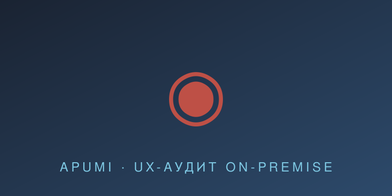

# SuperUX v5.3 — Public Demo

<p align="center"></p>


## За 30 секунд

**Что это:** SuperUX v5.3: on-premise UX-аудит с ФЗ-152. Не отправляет данные в облако, работает локально.

**Кому:** Российские компании с ФЗ-152 — UX-исследования без утечки.

**Что доказано:** 109 passed + 1 skipped = 110 тестов.

**Чего не доказано (честно):** Только РФ-рынок, санкционные ограничения для экспорта.

---


**On-premise платформа автоматического UX-аудита с ИИ.** v5.3 — полная версия: OIDC, LDAP, CI, Docker, GTM-пакет, 109 тестов.

## Что нового в v5.3

- **OIDC + LDAP** — SSO для enterprise (Keycloak, Azure AD, Google, Active Directory)
- **CI** — GitHub Actions (Python 3.10/3.11/3.12 + Node 20)
- **Docker Compose** — ClickHouse + Redis + Vault + nginx TLS
- **GTM-пакет** — 6 файлов: emails для CPO/UX/CISO, demo-script, target-list, follow-up
- **109 тестов** (было 33 в v5.2)
- **WOW-дашборд** — Live-терминал, тепловая карта, donut, таблица экономики, калькулятор

## Проблема

EU AI Act и ФЗ-152 требуют защиты ПДн в UX-логах. Зарубежные SaaS (Maze, Hotjar, UserTesting) нельзя использовать в закрытом контуре.

## Что делает

| Модуль | Что |
|---|---|
| `core/pii.py` | Маскировка: карта (Luhn), СНИЛС, ИНН 10/12, паспорт, телефон, email, **ФИО**, мат |
| `core/behavior.py` | RAGE_CLICK, DEAD_CLICK, CHAOS_SCROLL, HESITATION, ABANDONMENT |
| `core/anomaly.py` | EWMA-детектор (variance floor, warmup 20) |
| `core/insights.py` | Бизнес-инсайт в ₽/мес (rate × monthly × AOV × conv × uplift) |
| `core/journal.py` | HMAC-цепочка (verify через `/v1/journal/verify`) |
| `core/siem.py` | CEF over UDP (ArcSight-совместимый) |
| `core/auth.py` + `core/oidc.py` + `core/ldap.py` | JWT + OIDC + LDAP + multi-tenant + RBAC |
| `core/kms.py` | Vault / File / Env |
| `core/ratelimit.py` | Token bucket middleware |
| `core/storage.py` | SQLite + ClickHouse (в roadmap) |

## Тесты

```bash
pytest tests/ -q  # 109 passed, 1 skipped
```

## Ограничения (честно)

- Не сертифицирован ФСТЭК, не в Реестре Минцифры.
- Пентест не проводился, нет SLA и референс-клиента.
- YandexGPT-адаптер — **[WIP]** (требует API-ключ; сейчас только локальный шаблонный LLM).
- ClickHouse — в коде, не в production-конфиге.

## Цена

| Уровень | Цена | Кому |
|---|---|---|
| Пилот | 600–900 тыс ₽ / 3 мес | Маркетплейс, ритейл |
| Годовая лицензия (после ФСТЭК) | 3,5–6 млн ₽ | Tier-1 банк |
| Агентство | 120–250 тыс ₽/мес | UX-студии |

**Важно:** Tier-1 банк — только после ФСТЭК-сертификации (12–18 мес). До этого — маркетплейсы, ритейл, агентства.

Контакт: apumiaaifund@gmail.com


## Data integrity

**No synthetic data in production.** External sources are documented in `sources.yaml` (Private repo) with official URLs, real verification dates, and status. No fabricated dates. Demo artifacts are clearly marked as examples.

**Никакой синтетики в продакшене.** Внешние источники — в `sources.yaml` (Private репо) с официальными URL, реальными датами, статусом. Ни одной придуманной даты. Demo — помечены как примеры.


## Лицензия

Proprietary. См. LICENSE. Исходный код — по запросу.
